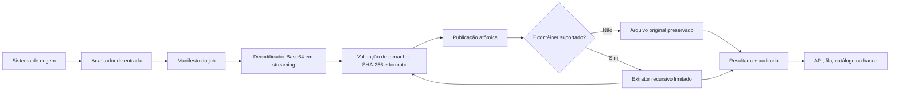

# Conversor ContentBase64

Conversor portátil, seguro e auditável para reconstruir arquivos recebidos como
Base64 e recuperar anexos existentes dentro de e-mails e arquivos compactados.

O projeto foi desenhado como um componente de infraestrutura: ele não conhece
clientes, processos funcionais, produtos ou regras de negócio. Qualquer API,
fila, automação ou sistema de dados pode utilizá-lo por CLI, biblioteca Rust ou
manifesto JSON.

## Explicação simples

Base64 não é um tipo de arquivo e não é uma compactação. É apenas uma forma de
representar bytes usando texto.

Quando um PDF, imagem ou planilha é convertido para Base64, o arquivo não deixa
de existir conceitualmente. Seus bytes foram apenas representados por
caracteres. Este projeto faz o caminho inverso:

1. recebe o texto Base64;
2. decodifica em fluxo, sem carregar arquivos grandes inteiros na memória;
3. calcula tamanho e SHA-256 enquanto grava;
4. valida se extensão, assinatura e MIME são coerentes;
5. publica o arquivo original por uma operação atômica;
6. se o arquivo for e-mail ou pacote compatível, extrai os anexos;
7. repete a análise para anexos dentro de anexos;
8. devolve um JSON com resultado, hashes, caminhos, linhagem, tempos e avisos.

Se os bytes recebidos forem os mesmos bytes usados na codificação, o SHA-256 do
arquivo reconstruído será igual ao SHA-256 do original. O conversor não renderiza
PDF, não executa macros e não recria documentos: ele recupera os mesmos bytes.

## Problemas que o projeto resolve

- APIs que transportam anexos no campo `contentBase64`;
- PDFs extensos, imagens, planilhas e apresentações;
- e-mails com anexos comuns;
- e-mails anexados dentro de outros e-mails;
- arquivos compactados com e-mails e novos arquivos compactados;
- processamento contínuo com retomada e quarentena;
- necessidade de provar que nenhum anexo foi sobrescrito silenciosamente;
- separação entre conteúdo binário e metadados persistidos em banco;
- integração agnóstica com APIs, filas, schedulers e pipelines de dados.

## Garantias principais

| Garantia | Como é implementada |
|---|---|
| Integridade | SHA-256 e tamanho calculados durante a gravação |
| Não publicar arquivo parcial | temporário no mesmo diretório e renomeação atômica |
| Não sobrescrever bytes diferentes | conflito de destino gera erro e quarentena |
| Reprocessar com segurança | mesmo caminho + mesmo tamanho + mesmo SHA-256 é idempotente |
| Baixo uso de memória | Base64 e arquivos ZIP são processados em streaming |
| Não perder formato desconhecido | bytes são preservados como `application/octet-stream` |
| Rastrear anexos aninhados | cada filho recebe `file_id`, `parent_file_id` e profundidade |
| Conter arquivos maliciosos | limites de tamanho, contagem, profundidade e taxa de expansão |
| Evitar Zip Slip | caminhos absolutos, `..` e links simbólicos são rejeitados |
| Auditar operação | `audit.jsonl` append-only e `result.json` estruturado |

## Arquitetura



### Fronteiras de responsabilidade

O componente faz:

- reconstrução de bytes;
- validação técnica;
- expansão de anexos;
- hash, métricas, linhagem, auditoria e status.

O componente não faz:

- autenticação no sistema de origem;
- consulta ou alteração de entidades de negócio;
- execução de comandos funcionais no sistema integrador;
- OCR, classificação, interpretação ou análise do conteúdo;
- armazenamento de credenciais;
- execução de arquivos, macros ou scripts recebidos;
- decisão sobre retenção legal.

Essa separação permite substituir o acionador ou o banco sem alterar o núcleo.

## Formatos

### Reconstrução

Qualquer sequência de bytes representada por Base64 válido pode ser
reconstruída. Isso inclui PDF, JPG, JPEG, PNG, BMP, TIFF, GIF, WEBP, documentos
Office atuais e legados, OpenDocument, XML, JSON, TXT, CSV, ZIP, RAR, 7z,
e-mails e formatos proprietários desconhecidos.

### Expansão recursiva

| Formato | Comportamento |
|---|---|
| EML, MHT, MHTML | extrai anexos MIME e mensagens RFC 5322 incorporadas |
| MSG, OFT | extrai anexos Outlook e mensagens MSG incorporadas |
| TNEF / `winmail.dat` | extrai anexos quando a assinatura TNEF é confirmada |
| ZIP | extrai entradas seguras e continua a recursão |
| 7z | extrai com decodificador Rust e continua a recursão |
| RAR | extrai por fronteira nativa isolada e continua a recursão |
| DOCX, XLSX, PPTX | preserva como documento; não desmonta o pacote Office |
| PST, OST, MBOX, DBX, OLM | preserva e sinaliza ausência de extrator recursivo |
| outros | preserva sem executar e registra a capacidade aplicada |

PST e OST são bancos de mensagens, não simples e-mails. Suporte responsável
exige parser especializado, limites próprios e corpus de QA. O projeto não
declara esses formatos como “extraídos” enquanto essa validação não existir.

Consulte [docs/FORMAT_SUPPORT.md](docs/FORMAT_SUPPORT.md) para a matriz completa.

## Início rápido

### Pré-requisitos

- Rust 1.97.1 ou compatível;
- toolchain C/C++ no Windows ou Linux para a dependência RAR;
- Windows: Windows SDK com `advapi32`;
- espaço em disco suficiente para temporários, originais e conteúdo extraído.

### Compilar

```powershell
cargo build --release --locked
```

O executável ficará em `target/release/base64-file-converter.exe` no Windows ou
`target/release/base64-file-converter` no Linux.

### Ver capacidades

```powershell
cargo run --locked -- capabilities
```

### Decodificar um arquivo

```powershell
cargo run --locked -- decode `
  --entrada .\payloads\document.pdf.b64 `
  --saida .\output\document.pdf `
  --nome-arquivo document.pdf
```

Usando `stdin`:

```powershell
Get-Content .\payloads\document.pdf.b64 -Raw |
  cargo run --locked -- decode `
    --entrada - `
    --saida .\output\document.pdf `
    --nome-arquivo document.pdf
```

### Processar um job

```powershell
$diretorioDemo = Join-Path $env:TEMP (
  "contentbase64-demo-" + [guid]::NewGuid().ToString("N")
)
Copy-Item .\examples\sample-job $diretorioDemo -Recurse

cargo run --locked -- process-job `
  --diretorio-job $diretorioDemo `
  --raiz-saida "$diretorioDemo-output" `
  --resultado "$diretorioDemo-result.json"
```

O exemplo é copiado antes do processamento porque `audit.jsonl` é gravado no
diretório do job como evidência operacional. Assim, a demonstração não altera
os arquivos versionados em `examples/`.

### Executar worker uma vez

```powershell
cargo run --locked -- spool `
  --raiz-spool .\spool `
  --raiz-saida .\output
```

### Executar continuamente

```powershell
cargo run --release --locked -- spool `
  --raiz-spool .\spool `
  --raiz-saida .\output `
  --observar `
  --intervalo-ms 1000 `
  --concorrencia 4
```

`Ctrl+C` solicita encerramento. O worker termina a varredura atual antes de sair.

No adaptador Python, uma falha antes da publicação não apaga o staging. Os
payloads já gravados são movidos para `producer-failed`, fora da fila consumida,
e o caminho de retenção é devolvido no erro.

## Contrato do job

O manifesto não possui campos específicos de um setor ou aplicação:

```json
{
  "schema_version": "base64-file-converter.job.v1",
  "job_id": "job-2026-000001",
  "correlation_id": "record-000001",
  "source_system": "document-api",
  "flow": "document-ingestion",
  "operation_id": "get-document-attachments",
  "integration_tag": "documents-v1",
  "business_keys": {
    "record_id": "000001"
  },
  "policy": {
    "max_decoded_bytes_per_attachment": 536870912,
    "preserve_unknown_formats": true,
    "continue_after_attachment_error": true,
    "quarantine_on_attachment_error": true,
    "expansion": {
      "enabled": true,
      "max_depth": 10,
      "max_extracted_files": 5000,
      "max_total_extracted_bytes": 2147483648,
      "max_single_extracted_bytes": 536870912,
      "max_compression_ratio": 200
    }
  },
  "attachments": [
    {
      "attachment_id": "attachment-0001",
      "filename": "document.pdf",
      "base64_path": "payloads/attachment-0001.b64",
      "output_relative_path": "records/000001/document.pdf",
      "expected_size_bytes": 123456,
      "expected_sha256": "optional-64-character-sha256",
      "expected_media_type": "application/pdf",
      "expand_containers": true
    }
  ]
}
```

Cada anexo deve informar exatamente uma fonte:

- `base64_path`: recomendado para escala, relativo ao diretório do job;
- `content_base64`: conveniente para chamadas pequenas, mas aumenta memória e JSON.

O schema formal está em [schemas/job.schema.json](schemas/job.schema.json).

## Acionadores

O núcleo não depende de um arquivo ou evento específico. Há quatro entradas:

1. CLI com arquivo;
2. CLI com `stdin`;
3. diretório com `job.json`;
4. spool de diretórios.

Outros acionadores podem gerar o mesmo manifesto:

- endpoint HTTP;
- mensagem de fila;
- evento de object storage;
- scheduler;
- automação de desktop;
- orquestrador de dados.

O exemplo [examples/python_adapter.py](examples/python_adapter.py) mostra como
uma API Python pode publicar um job sem decodificar o anexo.

## Modelo de spool

```text
spool/
├── inbox/
├── processing/
├── completed/
├── quarantine/
└── failed/
```

Publicação recomendada pelo produtor:

1. criar um diretório temporário dentro de `inbox`;
2. gravar `job.json` e os payloads;
3. sincronizar os arquivos;
4. renomear o diretório temporário para o `job_id`;
5. criar `READY` por último.

O worker reivindica um job renomeando o diretório de `inbox` para
`processing`. O diretório completo é preservado no estado final, incluindo
fonte Base64, manifesto, auditoria e resultado.

O marcador `READY` é um acionador possível, não uma dependência do núcleo. Use
`--sem-marcador-pronto` quando outro mecanismo garantir completude.

## Resultado e auditoria

### `result.json`

Contém:

- estado do job e de cada anexo;
- bytes decodificados e extraídos;
- SHA-256;
- caminho publicado;
- MIME, extensão e confiança da assinatura;
- arquivos filhos;
- relação pai-filho;
- profundidade;
- capacidade aplicada;
- avisos e erros sanitizados;
- tempos de início, fim e duração.

O resultado nunca repete `content_base64`.

### `audit.jsonl`

Cada linha é um evento JSON independente:

- `job_started`;
- `attachment_started`;
- `attachment_finished`;
- `attachment_failed`;
- `job_finished`.

O log é append-only. `fsync_audit_events=true` aumenta durabilidade por evento,
mas reduz throughput. O padrão usa `flush` e depende da publicação final do job.

## Estados

| Estado | Significado |
|---|---|
| `completed` | reconstrução e expansões esperadas concluídas |
| `partial` | original preservado, mas alguma expansão ficou incompleta |
| `quarantined` | há falha de anexo que exige investigação ou reprocessamento |
| `failed` | nenhum anexo válido foi produzido ou o contrato é inválido |

“Preservado” não significa “analisado”. Um PST preservado continua disponível,
mas não deve ser enviado a uma etapa que espera seus anexos sem verificar o
campo `container_capability`.

## Persistência recomendada

Arquivos binários grandes não devem ser armazenados como Base64 em colunas
comuns. A recomendação é:

### File system ou object storage

- arquivo original reconstruído;
- filhos extraídos;
- fonte Base64 durante a retenção definida;
- `result.json`;
- `audit.jsonl`.

### Banco relacional ou catálogo

- `job_id`;
- `correlation_id`;
- `attachment_id`;
- chaves de negócio;
- URI ou caminho;
- tamanho;
- SHA-256;
- MIME;
- estado;
- relação pai-filho;
- profundidade;
- timestamps;
- códigos de aviso.

Isso reduz crescimento do banco, permite deduplicação por hash e mantém
consulta rápida. A política de retenção da fonte Base64 deve ser definida pelo
dono dos dados.

## Segurança

O projeto assume que todo arquivo é não confiável.

- nunca executa arquivos;
- nunca habilita macros;
- nunca usa o nome recebido como caminho;
- rejeita caminhos absolutos e `..`;
- rejeita links simbólicos de ZIP;
- limita profundidade;
- limita número de arquivos;
- limita tamanho individual e total;
- limita taxa de compressão quando o formato informa os dois tamanhos;
- mantém temporário e destino no mesmo diretório;
- não sobrescreve destino divergente;
- não inclui Base64 nos logs;
- isola o único extrator nativo em uma função específica.

RAR utiliza uma biblioteca C/C++ incorporada pela dependência `unrar`. Em
ambientes de alto risco, execute o worker em contêiner sem privilégios, com
filesystem limitado, CPU/memória controladas e sem acesso de rede.

Mais detalhes em [docs/SECURITY.md](docs/SECURITY.md).

## Escala e desempenho

O custo mínimo da reconstrução é linear: cada byte precisa ser lido, decodificado,
gravado e incluído no SHA-256. O projeto evita cópias integrais desnecessárias:

- buffer de 256 KiB;
- Base64 em streaming;
- SHA-256 calculado na mesma passagem;
- jobs concorrentes com Rayon;
- anexos independentes processados em paralelo;
- limites configuráveis por arquivo e por árvore;
- resultado pequeno e separado do conteúdo.

Para cargas grandes, o gargalo costuma ser disco, rede ou descompactação, não a
instrução Base64 isolada. Concorrência excessiva pode reduzir throughput por
contenção de I/O. Comece com 2 a 4 jobs por volume e meça p50, p95, p99, bytes/s,
fila e espaço temporário.

No smoke benchmark local de 50 MiB, o processo utilizou no máximo 10,82 MiB de
memória observada. A média foi 7,4263 s, com mínimo de 2,6609 s e máximo de
11,5219 s. Os três arquivos tiveram o mesmo SHA-256 da origem. Esses valores
demonstram o comportamento de memória, mas não são SLA.

Não use estimativas de benchmark de outra máquina como SLA. Execute o roteiro
de [docs/BENCHMARK.md](docs/BENCHMARK.md) no hardware e storage de destino.
O modelo de memória, as fórmulas de capacidade e os ajustes de concorrência
estão em [docs/PERFORMANCE.md](docs/PERFORMANCE.md).

## QA

Verificação local completa:

```powershell
cargo fmt --all --check
cargo check --all-targets --locked
cargo clippy --all-targets --locked -- -D warnings
cargo test --all-targets --locked
cargo doc --no-deps --locked
cargo build --release --locked
python -m unittest discover -s tests_python -v
python scripts/audit_public_repo.py
```

Os testes cobrem:

- EML dentro de EML com PDF no último nível;
- ZIP Slip;
- Base64 inválido;
- formato desconhecido;
- idempotência;
- não vazamento de Base64 no resultado;
- validação PDF;
- divergência de assinatura;
- caminhos reservados;
- spool e concorrência inválida.
- publicação Python com `READY` por último;
- preservação do staging Python após falha.

Consulte [docs/QA.md](docs/QA.md).

## Estrutura

```text
.
├── src/
│   ├── decoder.rs       # Base64, hash, limites e publicação atômica
│   ├── expansion.rs     # e-mail, compactação e recursão
│   ├── media.rs         # assinatura, MIME e catálogo
│   ├── path_policy.rs   # nomes e caminhos não confiáveis
│   ├── job.rs           # contrato, auditoria e resultado
│   ├── spool.rs         # adaptador de fila em diretórios
│   ├── lib.rs           # API pública
│   └── main.rs          # CLI
├── tests/               # cenários ponta a ponta
├── tests_python/        # atomicidade e retenção do produtor Python
├── schemas/             # contratos JSON
├── examples/            # job e adaptador Python
├── docs/                # arquitetura, desempenho, segurança, operação e QA
└── .github/workflows/   # validação contínua
```

## Resultado de engenharia

Este case demonstra uma transformação de um requisito amplo, “recuperar qualquer
arquivo transportado como Base64 sem perder anexos”, em um componente com
fronteiras e evidências verificáveis:

- reconstrução universal dos bytes, sem lista fechada de extensões;
- expansão explícita somente onde há parser e testes;
- recursão de e-mails e pacotes com limites;
- integridade por tamanho e SHA-256;
- publicação atômica e reprocessamento idempotente;
- auditoria e linhagem sem replicar conteúdo sensível;
- acionadores substituíveis;
- operação contínua com estados e quarentena;
- memória constante no caminho de streaming;
- CI em Windows e Linux;
- política automatizada de dependências e atualização semanal;
- documentação de limitações, decisões e critérios operacionais.

O sucesso não é medido apenas porque um arquivo abre. A condição de aceite é
reproduzir os bytes, preservar a evidência, registrar a linhagem, limitar falhas
e tornar qualquer capacidade não suportada visível no resultado.

## Decisões criticadas

O projeto documenta não apenas o que foi escolhido, mas o custo das escolhas:

- Rust reduz classes de erro de memória, mas não torna parsers invulneráveis;
- RAR aumenta cobertura, mas introduz código nativo e build mais lento;
- `fsync` melhora durabilidade, mas reduz throughput;
- conteúdo inline simplifica integração, mas não escala como arquivo ou stream;
- paralelismo aumenta vazão até o ponto de saturação do storage;
- preservar formato desconhecido evita perda, mas não prova que o conteúdo é seguro;
- extrair tudo de PST/OST sem parser validado criaria uma falsa garantia.

Veja [docs/DECISIONS.md](docs/DECISIONS.md).

## Privacidade e portfólio

Este repositório é agnóstico e usa apenas nomes e exemplos fictícios. Não inclui:

- nomes de clientes;
- contratos de API privados;
- caminhos corporativos;
- dados, documentos ou hashes reais;
- credenciais;
- regras de negócio proprietárias.

## Licença

[MIT](LICENSE).
